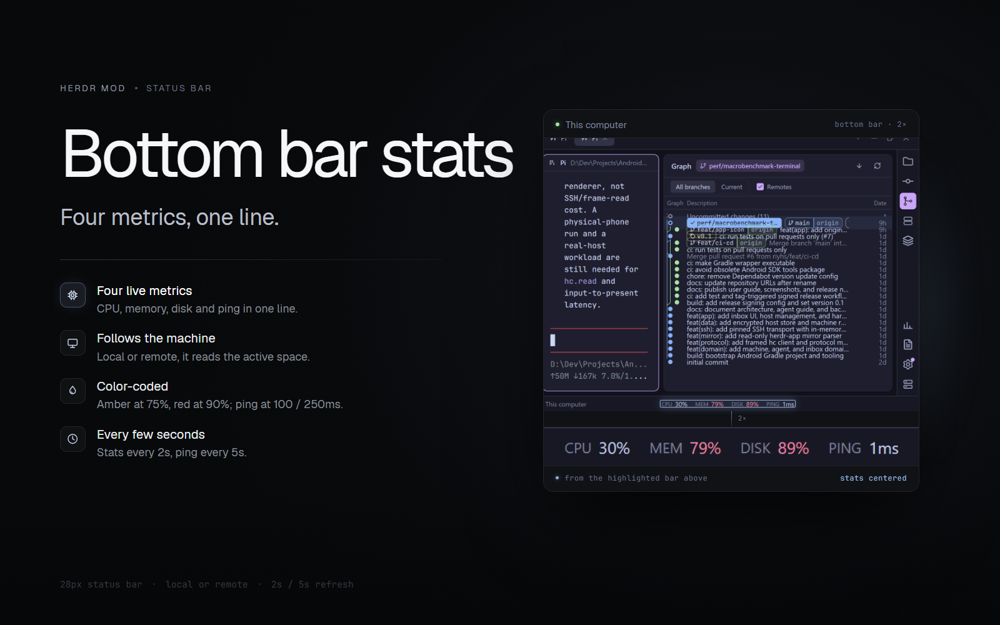

# Bottom bar stats

A 28px status bar for Herdr: the active machine's name on the left and CPU, memory, disk and ping centered in the bar. It follows the active space, so switching to a remote space swaps the numbers without changing the layout. Stats refresh every 2 seconds; ping every 5 seconds. Percentages turn amber at 75% and red at 90%; ping turns amber at 100ms and red at 250ms.



## Install

Ask the agent in your Herdr window:

> Read `~/.config/herdr-app/AGENTS.md`, then add this mod: https://github.com/riyhs/herdr-bottom-bar-stats

Then put it in a 28px status row. The minimal row:

```json
{
  "id": "status",
  "type": "row",
  "size": { "px": 28 },
  "resizable": false,
  "children": [
    {
      "id": "status-bar",
      "type": "block",
      "content": { "mod": "bottom-bar-stats" },
      "size": { "weight": 1 }
    }
  ]
}
```

The shipped `auto-rename` 1px sibling can stay next to it; the weight-1 block takes the rest of the row. The full probe and fallback details are in [RECIPE.md](RECIPE.md).

## What it does

- 28px full-width bar on the `chrome` background with a 1px top border; no icons or buttons.
- Left: the active machine's name, muted and truncated. Local spaces show "This computer".
- Center: `CPU`, `MEM`, `DISK` and `PING` groups, each label dim and value in the foreground, 14px apart and centered in the bar. A missing value is an en dash.
- Color thresholds: percentages are foreground below 75%, amber from 75% and red from 90%; ping is foreground below 100ms, amber from 100ms and red from 250ms.
- Tooltips show the machine name plus what is being measured, the loading state, offline state or probe error.
- Switching spaces re-probes immediately and discards results from the previous machine.
- Offline machines show dashes without running a probe. The first reading after launch or a space switch can take a second; the bar shows dashes until the probe returns.
- Thresholds are fixed in `main.js`; there is no history or click action.

## Requirements

- Herdr desktop app.
- A 28px status row in the layout. A shorter row clips the labels.
- Windows: `powershell.exe` for CPU and memory; `df` for disk.
- macOS/Linux: `/proc/loadavg` or `sysctl vm.loadavg`, `nproc` or `sysctl hw.ncpu`, `free` or `sysctl hw.memsize` + `vm_stat`, and `df`.
- `ping` for the latency reading. Remote machines must be reachable through Herdr; jump-host machines use the no-op round-trip fallback.

## Files

- `mods/bottom-bar-stats/main.js` — the `View`, timers, rendering and colors.
- `mods/bottom-bar-stats/stats.js` — the stats probe, parser and percentage math.
- `mods/bottom-bar-stats/ping.js` — platform ping flags, parser and `ssh -G` host resolution.
- `mods/bottom-bar-stats/mod.json` — `place: none`.
- `RECIPE.md` — the full build brief, probes and watch-outs.
- `preview.png` — the listing preview.

The stats and ping probes are adapted from the status-bar mod; the centered bar, timers, space switching and rendering are this mod's.

## License

Apache-2.0. See [LICENSE](LICENSE).
