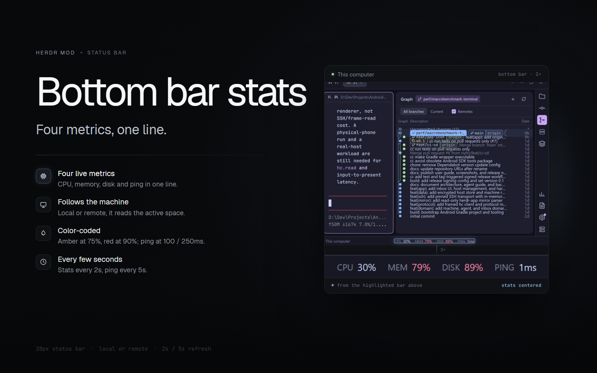

# Bottom bar stats

A 28px status bar for the bottom of the work area: the active machine's name on the left, and CPU, memory, disk and ping centered in the bar. It reads the machine of the active space, so switching to a remote space swaps the numbers without swapping the layout. Values refresh every 2 seconds; ping refreshes every 5 seconds. The numbers are color-coded, and each group has a tooltip with the machine and what is being measured.



The preview is a 2× screenshot of the work area. The highlighted rectangle at the bottom is the bar; the strip below is that same crop at 2×. The machine label stays on the left and the four metrics stay in the center — the crop is the center of the bar, not a detached mockup.

## What you see

- The bar: a 28px full-width row on the `chrome` background with a 1px `border` line on top. Text is 11.8px; letter-spaced labels are 10.4px and dim. There are no icons and no buttons.
- Left: the machine name, `muted` and truncated. Local spaces show "This computer"; remote spaces show the machine name.
- Center: four groups — `CPU`, `MEM`, `DISK`, `PING` — with the label in dim and the value in the foreground. Each group is 14px apart, and the whole group is centered in the bar. A missing value is an en dash.
- Color thresholds: percentages are `foreground` below 75%, `blocked` (amber) from 75%, and `ansi1` (red) from 90%. Ping is `foreground` below 100ms, `blocked` from 100ms, and `ansi1` from 250ms. A dash is `dim`.
- Tooltips: hovering a group shows the machine name plus "CPU, memory and disk, every 2s", "network round-trip, every 5s", "reading stats…", "offline", or the probe error. The tooltip follows the group, not each value.

## How it behaves

- On init the mod reads the active space's machine (`spaces().find(s => s.active)?.machine ?? null`) and starts a 2s stats timer and a 5s ping timer. Switching spaces re-probes immediately; sequence counters discard results from the previous machine.
- Stats run `sh -c "$STATS_PROBE"` on the active machine. On Windows the probe uses `powershell.exe` and `Get-CimInstance Win32_PerfFormattedData_PerfOS_Processor` for CPU and `Win32_OperatingSystem` for total/free memory, then `df -Pk` on `%SYSTEMDRIVE%`. Elsewhere it reads `/proc/loadavg` (or `sysctl vm.loadavg`), `nproc`, `free -b` (or `sysctl hw.memsize` + `vm_stat`), and `df -Pk /`, or `df -Pk /System/Volumes/Data` on macOS, where `/` is the sealed system volume.
- CPU is the Windows `PercentProcessorTime` total, or load average divided by CPU count elsewhere. MEM is used / total. DISK is used / (used + free) of the root filesystem, macOS Data volume or system drive. Each is rounded to a whole percent.
- Ping: the local machine pings `127.0.0.1`. For a remote machine the mod asks `hc(["machine", "ls", "--json"])` for a direct target, resolves it with `ssh -G` (using the `hostname` line), and runs `ping` with platform-specific flags from `ping.js` (`-n 1 -w 1500` on Windows, `-c 1 -W 1000` on Linux, `-c 1 -W 1500` on macOS). If no host resolves or `ping` fails, it falls back to timing a no-op `sh -c ":"` round-trip on that machine.
- If the machine is known to the app as `layout: "unavailable"`, the bar shows the offline state without running a probe. Probe failures show dashes and keep the error in the tooltip until the next tick. There is no history graph, per-core detail, or click action.

## Built from

- `mod.json`: `place: none`, title "Bottom bar stats". It draws only where a layout places it; it does not float or open a panel.
- Put it in a 28px status row, as the shipped status bar is. A minimal row:
  ```json
  {
    "id": "status",
    "type": "row",
    "size": { "px": 28 },
    "resizable": false,
    "children": [
      {
        "id": "status-bar",
        "type": "block",
        "content": { "mod": "bottom-bar-stats" },
        "size": { "weight": 1 }
      }
    ]
  }
  ```
  The shipped `auto-rename` 1px sibling can stay next to it; the weight-1 block takes the rest of the row.
- `main.js`: a `View` class with `init`, `activeMachine`, `refreshStats`, `refreshPing`, `pingHost`, `pingOnce`, `pctColor`, `pingColor`, `metric`, and `render`. It uses `h_flex` and `div`, keeps the stats group in the center with `justify_center()`, and pins the machine label to the left with `absolute().left(14).top(0).bottom(0)`. It uses `theme()` tokens `chrome`, `border`, `muted`, `dim`, `foreground`, `blocked`, `ansi1`; `exec`; `hc`; `window`; `spaces`; `machines`.
- `stats.js`: the `STATS_PROBE` script, `parseStats` (key/value lines from the probe), and `statsUsage` (percentage math, load fallback, disk free math).
- `ping.js`: `pingArgs` (platform flags), `parsePing` (first `=<nms` or `<nms` in the output), and `sshHostname` (the `hostname` line from `ssh -G`).
- No bundled art. It runs shell probes, `ping`, `hc machine ls --json`, and `ssh -G`; it does not read files outside those programs.

## Watch out

- The mod is `place: none`, so it will not appear until the layout has a block for it. A row shorter than 28px will clip the labels; the bar assumes the shipped 28px status-row height.
- The Windows probe needs `powershell.exe`; without it the stats stay at dashes. The Unix probe expects `/proc/loadavg` or `sysctl`, `nproc` (or `sysctl hw.ncpu`), and `free` or `vm_stat`; the disk probe always uses `df`.
- Remote stats require the machine to be reachable through Herdr. Machines reached through a jump host (`via`) are treated as not directly pingable; those fall back to the no-op round-trip.
- Ping is ICMP; firewalls and containers can block it even when SSH works. The fallback round-trip is a transport estimate, not a true ICMP latency.
- The first reading after launch or a space switch can take a second; the bar shows dashes until the probe returns. Errors are not retried faster than the 2s / 5s timers.
- The thresholds and wording are fixed in `main.js`; there are no settings. The disk value is one volume only (the root filesystem, or the Data volume on macOS), not every mount.

## Done when

- `herdr-app check mods/bottom-bar-stats` passes.
- With the block above in a 28px status row, the bar shows "This computer" on the left and four metrics centered in the bar; the stats update every 2s and ping every 5s.
- Switching to a remote space changes the left label to that machine's name and the numbers to that machine's stats; switching back restores the local values.
- A high load turns MEM or DISK amber at 75% and red at 90%; a slow ping turns PING amber at 100ms and red at 250ms.
- Hovering a group shows the machine and the probe description; an offline machine shows dashes with an offline tooltip.
- The highlighted crop in `preview.png` is the centered part of the bar; the machine name sits on the left of the card and the stats in the crop stay centered.
